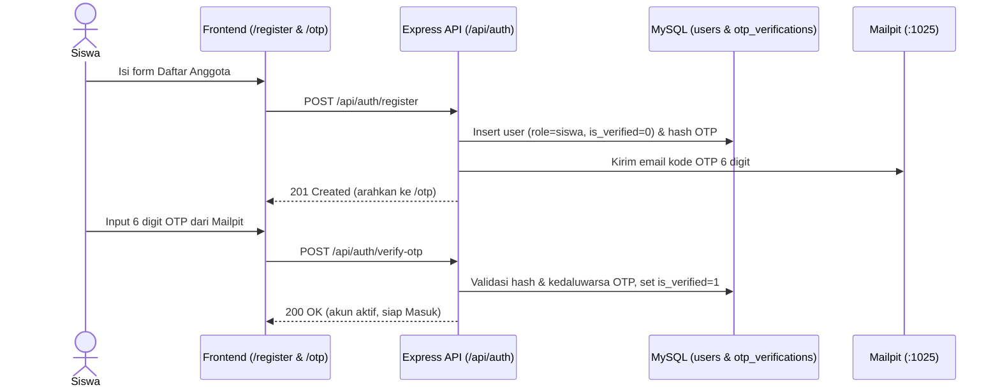

# Arsitektur Sistem — Denvora Lexora

Direktori ini menyimpan artefak arsitektur teknis, topologi layanan *client–server* terpisah, dan rancangan relasional basis data sistem informasi perpustakaan sekolah **Denvora Lexora** (*Where Knowledge Finds Its Way.*).

## Daftar Dokumen Arsitektur

| File | Deskripsi |
|---|---|
| [system-topology.svg](./system-topology.svg) | Diagram visual topologi terpisah Frontend Next.js, Backend Express REST API, MySQL, dan Mailpit SMTP lokal |
| [erd-database.md](./erd-database.md) | Entity Relationship Diagram (ERD) 5 tabel ternormalisasi (`users`, `categories`, `books`, `transactions`, `otp_verifications`) |
| [SYSTEM-ARCHITECTURE.md](../planning/SYSTEM-ARCHITECTURE.md) | Spesifikasi lengkap stack teknologi, lapisan kode, dan aturan kepatuhan |
| [API-SPECIFICATION.md](../planning/API-SPECIFICATION.md) | Kontrak endpoint REST API publik, Auth OTP, Siswa, Petugas, dan Admin |

---

## Topologi Sistem (100% Localhost Offline)

```mermaid
flowchart LR
    U[Pengguna / Siswa / Petugas / Admin] -->|Browser HTTP| FE["Frontend Next.js App Router\nhttp://localhost:3000"]
    FE -->|REST JSON + Cookie HttpOnly| API["Backend Express.js TypeScript\nhttp://localhost:5000"]

    subgraph Backend Layers
        direction TB
        MW["Middleware\nauthMiddleware · requireRole · Zod validate"]
        RT["Routes\n/api/catalog · /api/auth · /api/siswa · /api/petugas · /api/admin"]
        SVC["Services\nauth · otp · catalog · transaction · member · report"]
        MW --> RT --> SVC
    end

    API --> Backend Layers
    SVC -->|mysql2/promise Pool + Row Lock| DB[("MySQL 8.0 / MariaDB\ndenvora_lexora\n127.0.0.1:3306")]
    SVC -->|nodemailer SMTP| MP["Mailpit Local SMTP\n127.0.0.1:1025\nUI :8025"]
    SVC -->|fs/promises| FS["File Lokal\nbackend/logs & backend/exports"]
```

---

## Alur Autentikasi, Verifikasi OTP & RBAC



---

## Matriks Hak Akses (RBAC)

| Modul / Endpoint | Publik | Siswa | Petugas | Admin |
|---|---|---|---|---|
| Katalog Publik (`GET /api/catalog/books`, `/categories`) | V | V | V | V |
| Autentikasi & OTP (`/api/auth/*`) | V | V | V | V |
| Peminjaman & Pengembalian Sendiri (`/api/siswa/transactions/*`) | X | V | X | X |
| Pengelolaan Buku & Kategori (Tambah & Ubah) | X | X | V | V |
| Hapus Buku & Kategori | X | X | X | V |
| Kelola Anggota (`siswa`) & Transaksi Semua Anggota | X | X | V (baca anggota + transaksi) | V |
| Kelola Akun Staf (`petugas`) | X | X | X | V |
| Laporan Rekap & Ekspor CSV (`/reports/*`) | X | X | V | V |
