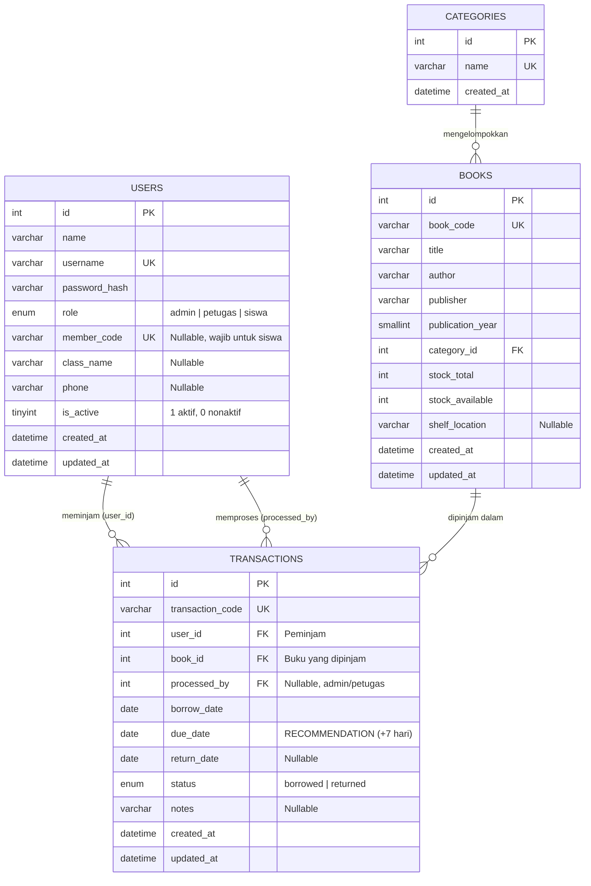

# Database Design & ERD — Denvora Lexora

**DBMS:** MySQL 8.0 / MariaDB (Kompatibel penuh dengan MySQL Workbench)  
**Nama Basis Data:** `db_denvora_lexora`  
**File Deliverable SQL:** `database/schema.sql`  

---

## 1. Identifikasi Entitas

Sesuai prinsip kesederhanaan struktur data (*tidak membuat tabel yang tidak diperlukan*), sistem menggunakan **4 entitas utama**:

1. **`users`** — Menyimpan seluruh akun pengguna sistem dengan pembeda `role`: `admin` (kendali penuh), `petugas` (`RECOMMENDATION` — operator perpustakaan), dan `siswa` (anggota peminjam).
2. **`categories`** — Menyimpan daftar kategori buku agar pengelompokan dan pencarian kondisi tertentu terstruktur.
3. **`books`** — Menyimpan katalog buku, kode buku, informasi penerbitan, serta jumlah stok total dan stok tersedia.
4. **`transactions`** — Menyimpan seluruh riwayat peminjaman dan pengembalian buku beserta aktor yang meminjam dan staf yang memproses (jika diproses/diedit oleh admin/petugas).

---

## 2. Entity Relationship Diagram (ERD)

---

## 3. Penjelasan Relasi Antarentitas

1. **`categories` (1) → `books` (N):** Satu kategori dapat dimiliki oleh banyak buku; setiap buku wajib merujuk satu `category_id` (`ON DELETE RESTRICT ON UPDATE CASCADE`).
2. **`users` (1) → `transactions` (N) via `user_id`:** Satu anggota (`siswa` atau peminjam) dapat melakukan banyak transaksi peminjaman (`ON DELETE RESTRICT ON UPDATE CASCADE`).
3. **`users` (1) → `transactions` (N) via `processed_by`:** Opsional (`NULL` jika siswa meminjam/mengembalikan langsung lewat dashboard siswa; berisi `id` Admin/Petugas jika dibuat/diubah melalui menu CRUD Transaksi Admin/Petugas, `ON DELETE SET NULL ON UPDATE CASCADE`).
4. **`books` (1) → `transactions` (N):** Satu judul buku dapat tercatat dalam banyak riwayat transaksi sepanjang waktu (`ON DELETE RESTRICT ON UPDATE CASCADE`).

---

## 4. Spesifikasi Struktur Tabel (Data Dictionary)

### A. Tabel `users`

| Kolom | Tipe Data | Constraint | Keterangan |
|---|---|---|---|
| `id` | `INT UNSIGNED` | `PK, AUTO_INCREMENT` | ID unik pengguna |
| `name` | `VARCHAR(100)` | `NOT NULL` | Nama lengkap |
| `email` | `VARCHAR(120)` | `NULL, UNIQUE` | Email lokal/sekolah untuk verifikasi OTP Mailpit |
| `username` | `VARCHAR(50)` | `NOT NULL, UNIQUE` | Username untuk login |
| `password_hash` | `VARCHAR(255)` | `NOT NULL` | Hash bcrypt dari password |
| `role` | `ENUM('admin','petugas','siswa')` | `NOT NULL, DEFAULT 'siswa'` | Hak akses pengguna |
| `member_code` | `VARCHAR(30)` | `NULL, UNIQUE` | NIS / Kode Anggota (otomatis/diisi saat daftar siswa) |
| `class_name` | `VARCHAR(50)` | `NULL` | Kelas siswa (mis. `XII RPL 1`) |
| `phone` | `VARCHAR(20)` | `NULL` | Nomor kontak siswa/petugas |
| `is_active` | `TINYINT(1)` | `NOT NULL, DEFAULT 1` | Status akun (`1` = aktif, `0` = nonaktif) |
| `is_verified` | `TINYINT(1)` | `NOT NULL, DEFAULT 1` | Status verifikasi email OTP (`0` sebelum verifikasi register, `1` setelah terverifikasi) |
| `created_at` | `TIMESTAMP` | `DEFAULT CURRENT_TIMESTAMP` | Waktu pembuatan |
| `updated_at` | `TIMESTAMP` | `DEFAULT CURRENT_TIMESTAMP ON UPDATE CURRENT_TIMESTAMP` | Waktu pembaruan |

**Indeks tambahan:** `INDEX idx_users_role_active (role, is_active)`

---

### B. Tabel `categories`

| Kolom | Tipe Data | Constraint | Keterangan |
|---|---|---|---|
| `id` | `INT UNSIGNED` | `PK, AUTO_INCREMENT` | ID kategori |
| `name` | `VARCHAR(60)` | `NOT NULL, UNIQUE` | Nama kategori (mis. `Teknologi`, `Sastra`, `Sains`) |
| `created_at` | `TIMESTAMP` | `DEFAULT CURRENT_TIMESTAMP` | Waktu pembuatan |

---

### C. Tabel `books`

| Kolom | Tipe Data | Constraint | Keterangan |
|---|---|---|---|
| `id` | `INT UNSIGNED` | `PK, AUTO_INCREMENT` | ID unik buku |
| `book_code` | `VARCHAR(30)` | `NOT NULL, UNIQUE` | Kode buku internal / ISBN |
| `title` | `VARCHAR(150)` | `NOT NULL` | Judul buku |
| `author` | `VARCHAR(100)` | `NOT NULL` | Nama pengarang |
| `publisher` | `VARCHAR(100)` | `NOT NULL` | Nama penerbit |
| `publication_year` | `YEAR` | `NOT NULL` | Tahun terbit |
| `category_id` | `INT UNSIGNED` | `NOT NULL, FK -> categories(id)` | Relasi kategori |
| `stock_total` | `INT UNSIGNED` | `NOT NULL, DEFAULT 1` | Total eksemplar yang dimiliki perpustakaan |
| `stock_available` | `INT UNSIGNED` | `NOT NULL, DEFAULT 1` | Eksemplar yang sedang tersedia untuk dipinjam |
| `shelf_location` | `VARCHAR(30)` | `NULL` | Lokasi rak (mis. `RAK-A1`) |
| `created_at` | `TIMESTAMP` | `DEFAULT CURRENT_TIMESTAMP` | Waktu pembuatan |
| `updated_at` | `TIMESTAMP` | `DEFAULT CURRENT_TIMESTAMP ON UPDATE CURRENT_TIMESTAMP` | Waktu pembaruan |

**Indeks tambahan:** `INDEX idx_books_search (title, author)`, `INDEX idx_books_stock (stock_available)`

---

### D. Tabel `transactions`

| Kolom | Tipe Data | Constraint | Keterangan |
|---|---|---|---|
| `id` | `INT UNSIGNED` | `PK, AUTO_INCREMENT` | ID transaksi |
| `transaction_code` | `VARCHAR(30)` | `NOT NULL, UNIQUE` | Kode transaksi unik (mis. `TRX-20261125-0001`) |
| `user_id` | `INT UNSIGNED` | `NOT NULL, FK -> users(id)` | Anggota yang meminjam |
| `book_id` | `INT UNSIGNED` | `NOT NULL, FK -> books(id)` | Buku yang dipinjam |
| `processed_by` | `INT UNSIGNED` | `NULL, FK -> users(id)` | Admin/Petugas pemroses (jika via menu admin/petugas) |
| `borrow_date` | `DATE` | `NOT NULL` | Tanggal pinjam |
| `due_date` | `DATE` | `NOT NULL` | Tanggal jatuh tempo (`RECOMMENDATION`: default `borrow_date + 7 hari`) |
| `return_date` | `DATE` | `NULL` | Tanggal aktual buku dikembalikan |
| `status` | `ENUM('borrowed','returned')` | `NOT NULL, DEFAULT 'borrowed'` | Status peminjaman |
| `notes` | `VARCHAR(255)` | `NULL` | Catatan opsional transaksi |
| `created_at` | `TIMESTAMP` | `DEFAULT CURRENT_TIMESTAMP` | Waktu pencatatan |
| `updated_at` | `TIMESTAMP` | `DEFAULT CURRENT_TIMESTAMP ON UPDATE CURRENT_TIMESTAMP` | Waktu pembaruan |

**Indeks tambahan:** `INDEX idx_trx_status_date (status, borrow_date)`, `INDEX idx_trx_user (user_id, status)`

---

## 5. Aturan Integritas & Transaksi SQL

1. **Peminjaman Atomik:**
   - Buka transaksi (`START TRANSACTION`).
   - Kunci baris buku dengan `SELECT stock_available FROM books WHERE id = ? FOR UPDATE`.
   - Jika `stock_available <= 0`, lakukan `ROLLBACK` dan kembalikan error `409 Conflict`.
   - Kurangi stok: `UPDATE books SET stock_available = stock_available - 1 WHERE id = ?`.
   - Sisipkan baris baru di `transactions` dengan `status = 'borrowed'`.
   - `COMMIT`.
2. **Pengembalian Atomik:**
   - Buka transaksi (`START TRANSACTION`).
   - Kunci baris transaksi `SELECT id, book_id, status FROM transactions WHERE id = ? FOR UPDATE`.
   - Jika `status = 'returned'`, lakukan `ROLLBACK` dan kembalikan error `409 Conflict`.
   - Perbarui transaksi: `UPDATE transactions SET status = 'returned', return_date = CURRENT_DATE WHERE id = ?`.
   - Tambah stok tersedia: `UPDATE books SET stock_available = LEAST(stock_total, stock_available + 1) WHERE id = ?`.
   - `COMMIT`.
3. **Penghapusan Data Master:**
   - Buku tidak boleh dihapus jika memiliki transaksi aktif (`status = 'borrowed'`).
   - Anggota tidak boleh dihapus permanen jika masih memiliki pinjaman aktif (`status = 'borrowed'`).
