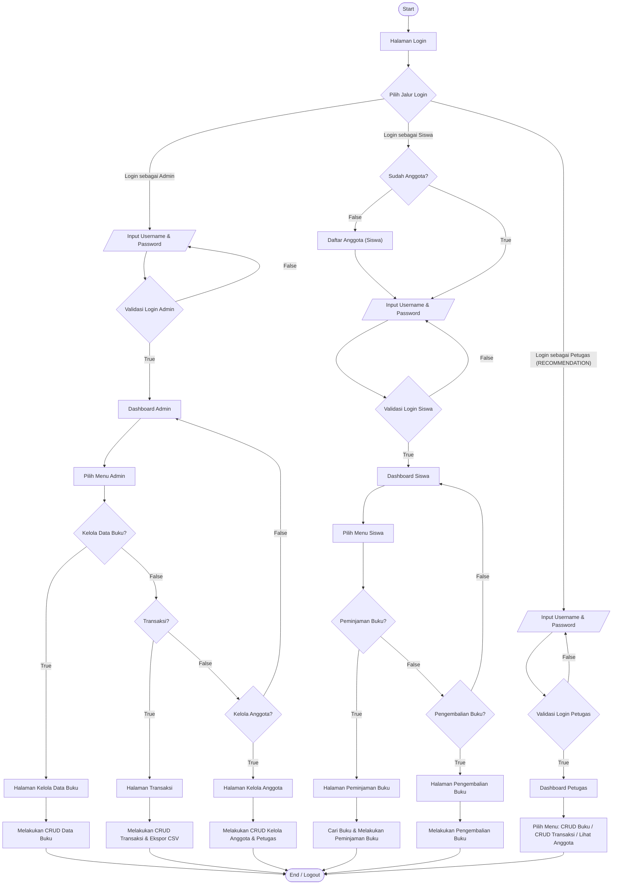
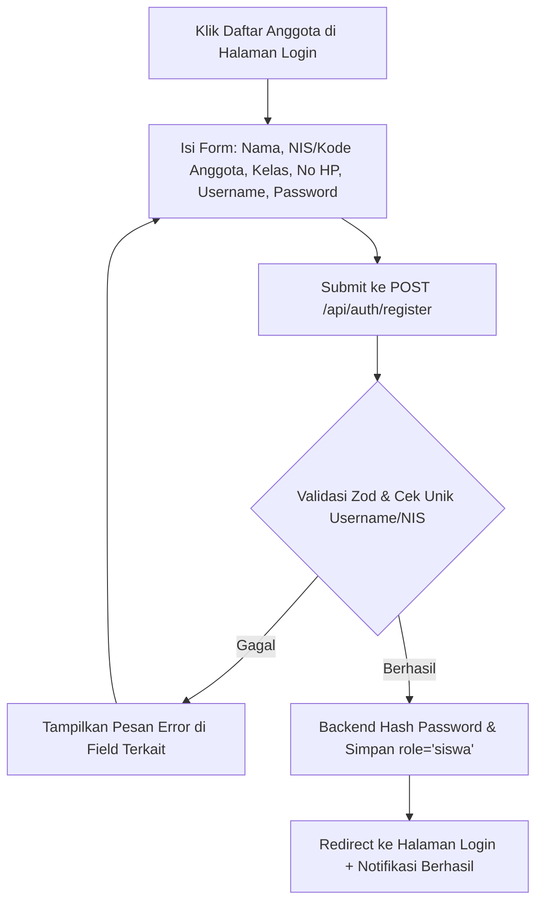
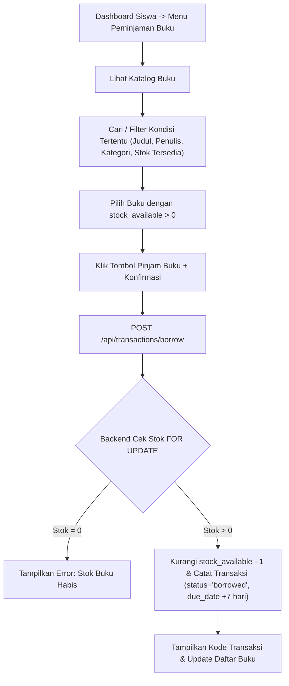
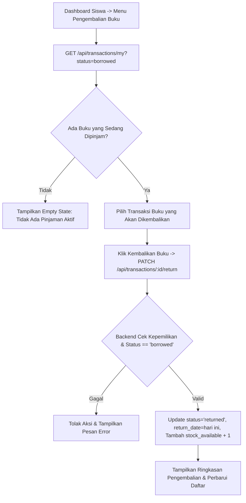
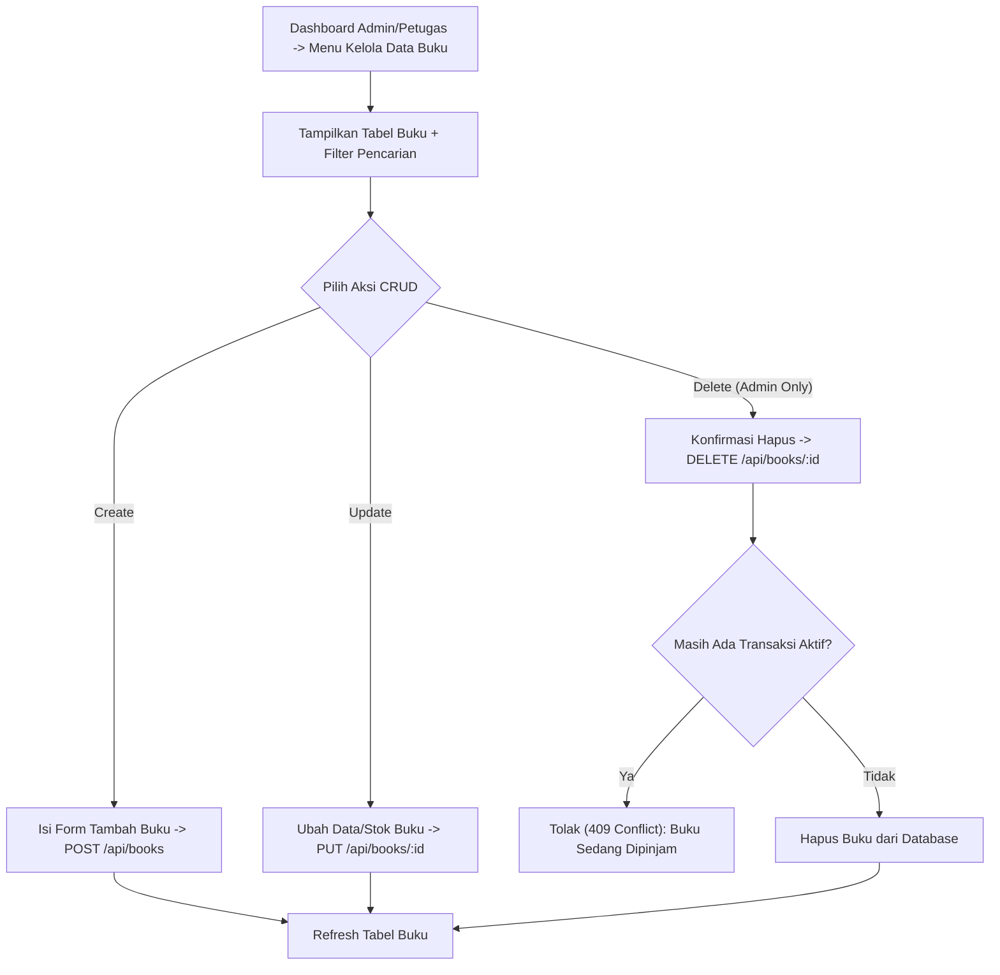
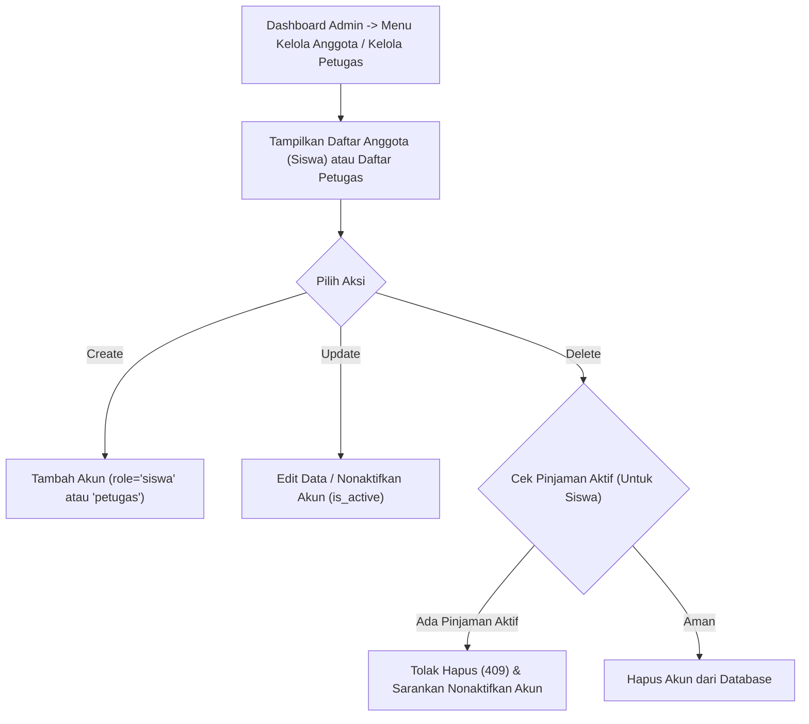
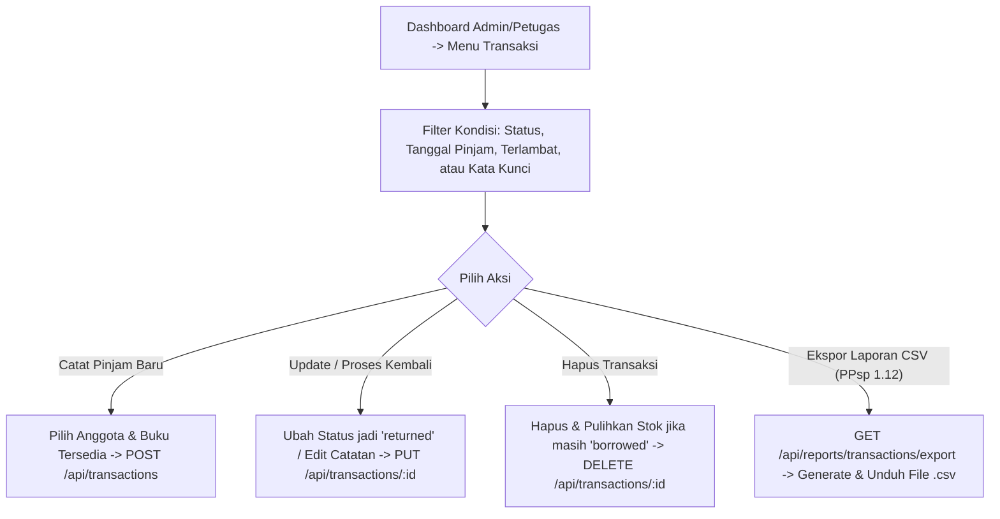

# User Flow — Denvora Lexora

**Acuan Utama:** Flowmap Sistem Usulan pada Dokumen Soal Praktik Kejuruan (SPK-3/4)  
**Peran Sistem:** `Admin` (Mandatory), `Siswa` (Mandatory), `Petugas` (`RECOMMENDATION`)  

---

## 1. Alur Utama Sistem (Mengikuti Flowmap Resmi SPK-3/4)

Diagram berikut memetakan alur resmi dari *Start → Login → Pemilihan Peran → Dashboard & Pilih Menu → Eksekusi Fitur → End*, dengan tambahan cabang operasional `Petugas` (`RECOMMENDATION`) tanpa mengubah alur inti `Admin` dan `Siswa`.

> [!NOTE]
> Pada implementasi UI halaman `/login`, form input tetap satu kesatuan (*Username & Password*) agar praktis, namun tersedia panduan/tab pilihan jalur (`Siswa` / `Admin & Petugas`) serta tautan **"Belum jadi anggota? Daftar Anggota"** sehingga secara visual maupun alur tetap sejalan 100% dengan flowmap SPK-3/4.

---

## 2. Flow Pendaftaran Anggota (Khusus Siswa)

---

## 3. Flow Peminjaman Buku (Siswa)

---

## 4. Flow Pengembalian Buku (Siswa)

---

## 5. Flow Pengelolaan Data Buku (Admin & Petugas)

---

## 6. Flow Pengelolaan Anggota & Petugas (Admin)

*(Catatan: `Petugas` hanya memiliki akses **Read-only** melihat daftar anggota saat memproses peminjaman di meja layanan).*

---

## 7. Flow CRUD Transaksi & Ekspor File CSV (Admin & Petugas)

